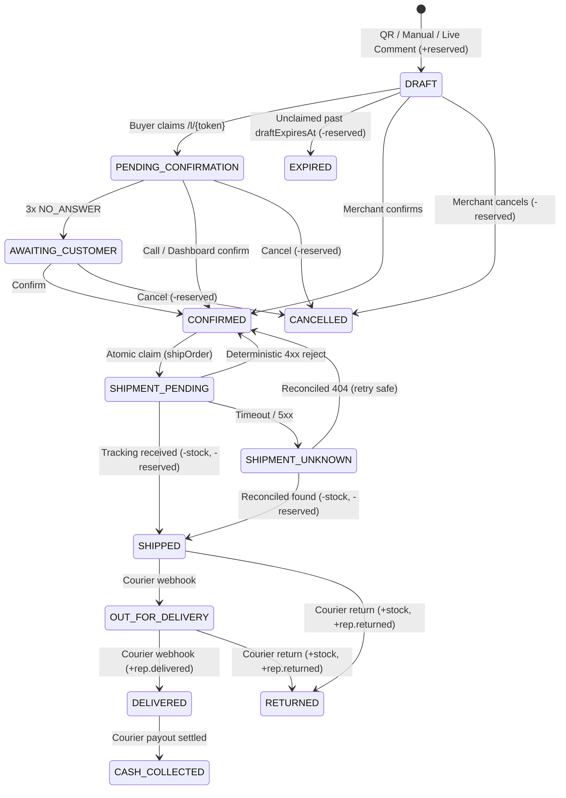

# LiveDZ — Technical Architecture & Development Plan

**Project:** Hybrid TikTok Live & QR Commerce Platform for Algerian COD Sellers  
**Audience:** Engineering & Product Team  
**Date:** 24 November 2026  
**Stack:** Next.js 16 (App Router, React 19, Turbopack) · PostgreSQL 16 · Prisma 7.10 · Firebase Auth · Zod 4 · Vitest 5 · `tiktok-live-connector` v2 · Docker

---

## 1. Executive Summary

LiveDZ solves the core operational bottleneck for Algerian cash-on-delivery (COD) social sellers: converting chaotic TikTok Live comments and offline/QR traffic into confirmed, shippable courier parcels without overselling stock, losing buyer coordinates, or shipping duplicate parcels.

Every order channel feeds into **one transactional order pipeline** with unified stock accounting, phone confirmation tracking, buyer reputation scoring, and atomic courier handoff:

```
┌─────────────────────────┐   ┌─────────────────────────────┐   ┌────────────────────────┐
│   Channel 1: QR / Link  │   │ Channel 2: TikTok Live      │   │ Channel 3: Manual      │
│   /q/{cardToken}        │   │ Worker WS -> DRAFT          │   │ Merchant Dashboard     │
│   (Full buyer details)  │   │ -> Buyer claims /l/{token}  │   │ (Phone / DM orders)    │
└────────────┬────────────┘   └──────────────┬──────────────┘   └───────────┬────────────┘
             │                               │                              │
             └───────────────────────────────┼──────────────────────────────┘
                                             ▼
                 ┌────────────────────────────────────────────────────────┐
                 │  Unified Order Pipeline (PostgreSQL + Prisma)          │
                 │  · Idempotency keys + 10-min anti-spam dedup           │
                 │  · Atomic Variant stock reservation + expiry sweeper   │
                 │  · 69 Algerian wilayas (58 courier + 11 mapped)        │
                 │  · Per-wilaya DeliveryRate (HOME vs STOPDESK)          │
                 └───────────────────────────┬────────────────────────────┘
                                             ▼
                 ┌────────────────────────────────────────────────────────┐
                 │  Merchant Ops & Phone Confirmation                     │
                 │  · CallLog tracking (3 no-answer -> AWAITING_CUSTOMER) │
                 │  · BuyerReputation risk warnings (returns / refusals)  │
                 │  · Viewer LiveQuestion feed                            │
                 └───────────────────────────┬────────────────────────────┘
                                             ▼
                 ┌────────────────────────────────────────────────────────┐
                 │  Courier Handoff & COD Lifecycle                       │
                 │  · AES-256-GCM credentials + key rotation ring         │
                 │  · SHIPMENT_UNKNOWN safety + attempt reconciliation    │
                 │  · Webhook status sync -> DELIVERED / CASH_COLLECTED   │
                 │  · Automatic stock return on RETURNED                  │
                 └────────────────────────────────────────────────────────┘
```

---

## 2. Production Hardening & Architectural Upgrades

The initial MVP prototype revealed several critical production gaps for Algerian COD and TikTok Live scale. Below is the complete remediation architecture implemented across the codebase:

| # | Production Risk | Implemented Solution | Key Files |
|---|---|---|---|
| **1** | **Unreachable TikTok Live buyers** — comments have no phone or address; DRAFTs pile up | **Hybrid Claim Link `/l/{sessionToken}`**: Seller shows link/QR during Live; buyer enters `@handle`, reviews reserved items + delivery fee, submits phone/wilaya/commune/address (`DRAFT → PENDING_CONFIRMATION`). Unclaimed drafts expire after `Merchant.draftHoldMinutes` (default 120m). | `src/lib/live/claim.ts`, `src/app/l/[token]/*`, `src/lib/live/orders.ts` |
| **2** | **WebSockets inside Next.js API routes** — breaks serverless/multi-instance deploys and resets on reload | **DB-Backed Worker & Leases**: Web tier writes `LiveSession` commands (`PENDING`, `STOPPING`). Dedicated `worker` process claims sessions atomically via `SELECT ... FOR UPDATE SKIP LOCKED`, holds WebSockets, sends 10s heartbeats (`30s` lease), and sweeps expired drafts. | `src/lib/live/session-manager.ts`, `src/worker/live-worker.ts`, `src/app/api/live/*` |
| **3** | **Duplicate parcels on courier timeout** — blind rollback to `CONFIRMED` lets merchant ship twice | **Shipment Idempotency & Reconciliation**: `shipOrder` increments `shipAttempts` and sets `shipmentAttemptKey` (`{orderId}-a{n}`), passing `Idempotency-Key` header. Timeouts/5xx transition to `SHIPMENT_UNKNOWN` instead of `CONFIRMED`. `reconcileUnknownShipment()` checks DzShip before releasing for retry. | `src/lib/shipping.ts`, `src/lib/couriers/dzship.ts` |
| **4** | **Stock model ambiguity** — reserve vs deduct inconsistency & spammer stock exhaustion | **4-Step Stock Lifecycle + Anti-Spam**: Reserve at creation (`reserved += qty`), Commit on `SHIPPED` (`stock -= qty, reserved -= qty`), Release on `CANCELLED`/`EXPIRED` (`reserved -= qty`), Restock on `RETURNED` (`stock += qty`). Anti-spam prevents same viewer locking stock repeatedly within 10 min. | `src/lib/orders.ts`, `src/lib/live/orders.ts`, `src/lib/merchant-orders.ts`, `src/lib/courier-sync.ts` |
| **5** | **Incomplete Algerian COD lifecycle** — stopped at `SHIPPED`; missing calls, returns, reputation, delivery fees | **End-to-End COD Operations**: Added `PENDING_CONFIRMATION`, `CASH_COLLECTED`, `EXPIRED`; `CallLog` workflow (`NO_ANSWER` x3 -> `AWAITING_CUSTOMER`); `BuyerReputation` per store; `DeliveryRate` per wilaya (`HOME`/`STOPDESK`); `/api/webhooks/courier` status sync. | `src/lib/order-status.ts`, `src/lib/call-confirm.ts`, `src/lib/reputation.ts`, `src/lib/delivery-rates.ts`, `src/lib/courier-sync.ts` |
| **6** | **Fragile comment parser** — hardcoded `K`, no question filter, `K1 42` ambiguity | **Hardened Multilingual Parser**: Normalizes Arabic-Indic (`٠-٩`), Persian (`۰-۹`), and full-width chars (`Ｋ１`). Configurable `Merchant.liveCodePrefix`. Flags questions (`شحال`, `combien`, `?`) to `LiveQuestion` instead of creating orders. Disambiguates `K1 42` against real product variants. | `src/lib/live/parser.ts`, `src/lib/live/orders.ts` |
| **7** | **Key rotation & proxy lock-in** | **Key Ring & Adapter Isolation**: `CREDENTIALS_KEY_PREV` fallback in `parseKeyRing` / `decryptSecretWithKeys`. DzShip isolated in `src/lib/couriers/dzship.ts` ready for direct Yalidine/ZR adapters. | `src/lib/crypto-secrets.ts`, `src/lib/courier-accounts.ts` |

---

## 3. Data Model (Prisma Schema)

All entities are scoped by `merchantId` for strict multi-tenant isolation (`prisma/schema.prisma`):

- **Identity & Store**: `Merchant` (`liveCodePrefix`, `draftHoldMinutes`), `Membership` (`OWNER` | `MODERATOR`, Firebase UID)
- **Catalog & Attribution**: `Product`, `Variant` (`stock`, `reserved`), `Affiliate`, `Card` (`token` for `/q/{token}`)
- **Orders & COD Ops**: `Order`, `OrderItem`, `CallLog` (`CONFIRMED`, `NO_ANSWER`, `UNREACHABLE`, `CANCELLED`, `CALLBACK`)
- **Live Commerce**: `LiveSession` (`sessionToken` for `/l/{token}`, `status`, `workerId`, `leaseExpiresAt`, `heartbeatAt`, counters), `LiveQuestion`
- **Logistics & Risk**: `CourierAccount` (AES-256-GCM `credentialsEnc` with AAD), `DeliveryRate` (per `wilayaCode` 1..58: `homeDzd`, `stopdeskDzd`), `BuyerReputation` (per-merchant `phone` stats + `blocked`), `Commune` (1,541 Algerian communes)

### Algerian Wilaya Mapping (69 → 58)
- `src/lib/countries/dz/regions.ts` stores all **58 historical wilayas** plus **11 new wilayas** (law of April 2026: Aflou, Barika, El Kantara, Bir El Ater, El Aricha, Ksar Chellala, Ain Oussera, Messaad, Ksar El Boukhari, Bou Saada, El Abiodh Sidi Cheikh).
- `Order.officialRegionKey` retains the buyer's exact region key (e.g. `"n-barika"`), while `Order.wilayaCode` maps to the parent courier code `1..58` (e.g. `5`) for delivery rate lookup and courier API dispatch.

---

## 4. State Machines & Stock Invariants

### 4.1 Order Lifecycle (`src/lib/order-status.ts`)



### 4.2 Stock Accounting Invariant
At all times for any `Variant`:
$$\text{Available} = \text{stock} - \text{reserved} \ge 0$$

| Event | `stock` | `reserved` | Net Available |
|---|---|---|---|
| Order created (`QR_LINK`, `LIVE_COMMENT`) | `0` | `+qty` | `-qty` |
| Order `CANCELLED` or `EXPIRED` | `0` | `-qty` | `+qty` |
| Parcel `SHIPPED` (or reconciled `SHIPPED`) | `-qty` | `-qty` | `0` (already deducted) |
| Parcel `RETURNED` from courier | `+qty` | `0` | `+qty` |

---

## 5. Live Capture Worker & Parser Specification

### 5.1 Worker Coordination (`src/worker/live-worker.ts`)
- **Why separate process:** Long-lived TikTok WebSocket connections cannot survive serverless function lifecycles or horizontal Next.js scaling.
- **Claiming:** `claimNextSession(workerId)` runs `SELECT ... FROM "LiveSession" WHERE status = 'PENDING' OR (status = 'RUNNING' AND leaseExpiresAt < NOW()) FOR UPDATE SKIP LOCKED`.
- **Heartbeat & Stop:** Every 10s, `renewSessionLease` extends `leaseExpiresAt` (+30s) and saves counters (`commentsSeen`, `ordersCreated`, `questionsSeen`, `errors`). Returning `false` signals `STOPPING` from the dashboard and cleanly closes the socket.
- **Draft Sweeper:** Every 60s, `expireStaleLiveDrafts()` atomically expires unclaimed `LIVE_COMMENT` `DRAFT` orders past `draftExpiresAt` and releases reserved stock.

### 5.2 Comment Parser Rules (`src/lib/live/parser.ts`)
1. **Normalize:** Strip zero-width marks, convert full-width ASCII (`Ｋ１` → `K1`), convert Eastern-Arabic & Persian digits (`٣`/`۳` → `3`).
2. **Question Filter:** Check `?`, `؟`, `combien`, `prix`, `tarif`, `شحال`, `بقداه`, `قداه`, `سعر`, `ثمن`, `توصيل`, `livraison`, `dispo`, `كاين`, `متوفر`, `وين`, etc. Questions record a `LiveQuestion` row instead of creating an order.
3. **Code Matching:** Match `[A-Z]\s*\d{1,3}` or `(code|cod|كود)\s*\d{1,3}` mapped to `${merchant.liveCodePrefix}${num}`.
4. **Catalog Disambiguation:** `createLiveOrder` fetches the matching `Product` and its `Variant` sizes/colors, then re-parses so `"K1 42"` resolves to `size: "42", quantity: 1` rather than quantity 42.
5. **Deduplication:** Primary key `live:msg:{msgId}` (or 10-minute window key) PLUS an active-draft check per `(merchantId, tiktokUsername, productId)` within 10 minutes to block comment spam.

---

## 6. Security & Dependency Risk Register

| Component | Risk | Current Mitigation | Planned Next Step |
|---|---|---|---|
| **`tiktok-live-connector` v2** | Unofficial reverse-engineered protocol; TikTok can break or require EulerStream signing (`TIKTOK_SIGN_API_KEY`) | Isolated behind `LiveConnection` interface (`src/lib/live/types.ts` & `tiktok.ts`); dashboard labels capture as best-effort | Monitor error rates per session; configure EulerStream key for production volume |
| **DzShip Proxy (`freeship.dzbuild.com`)** | Decrypted courier API keys transit a 3rd-party proxy; single point of failure | Explicit `credentialsEnc` decryption only inside `shipOrder` / `reconcileUnknownShipment` | Build direct `Yalidine` and `ZR Express` adapters behind a common `CourierAdapter` interface |
| **`CREDENTIALS_KEY`** | Single static key blocks rotation | Ciphertexts prefixed with `v1.`; `parseKeyRing` supports `CREDENTIALS_KEY_PREV` | Add background re-encryption script when rotating keys |
| **Courier Webhooks** | Spoofed delivery/return callbacks could manipulate stock | `COURIER_WEBHOOK_SECRET` verified with `crypto.timingSafeEqual` | Add per-provider HMAC signature verification when connecting direct couriers |
| **Firebase Google-Only Login** | Many Algerian COD merchants operate solely via mobile phone number | Session cookie `httpOnly`, `SameSite=Lax`, `ORIGIN` CSRF check | Evaluate Firebase Phone Auth (OTP) against Mobilis/Djezzy/Ooredoo SMS deliverability & cost |

---

## 7. Deployment & Operations

### 7.1 Staging Architecture (`docker-compose.yml` + `docker-compose.prod.yml`)
Three containers share an internal Docker network:
1. **`db` (`postgres:16`)**: Persistent volume `pgdata`, local healthcheck (`pg_isready`).
2. **`app` (`Dockerfile` target `runner`)**: Next.js 16 standalone server on port `3000`.
3. **`worker` (`Dockerfile` target `worker`)**: Runs `npx tsx src/worker/live-worker.ts` for TikTok WebSocket sessions & draft expiry.

> **Vercel vs Docker/Cloud Run:** Vercel can host the `app` tier cleanly because `/api/live/*` no longer holds WebSockets, **provided** the `worker` container runs separately on a VPS/Fly.io/Cloud Run (always-on) connected to the same Postgres database. For unified single-host staging, Docker Compose runs both `app` and `worker` together.

### 7.2 Staging Launch Commands
```bash
# 1. Configure .env.local from .env.example (DATABASE_URL, FIREBASE_*, CREDENTIALS_KEY, COURIER_WEBHOOK_SECRET)
cp .env.example .env.local

# 2. Apply migrations & seed communes
npx prisma migrate deploy --config prisma7.config.ts
npm run db:communes

# 3. Start full staging stack (db + app + worker)
docker compose -f docker-compose.yml -f docker-compose.prod.yml up -d --build
```

---

## 8. Development Roadmap (Team Execution Plan)

| Phase | Scope | Status |
|---|---|---|
| **Phase 1: Core QR & Multi-Tenant Foundation** | Next.js 16, Postgres 16, Prisma 7, `/q/{token}`, atomic stock reservation, 69 DZ wilayas, Firebase Auth + CSRF, AES-256-GCM courier credentials | **Done** |
| **Phase 2: Hybrid Live + Worker + Full COD Lifecycle** | Hardened parser + `tiktok-live-connector` v2, DB-backed `LiveSession` worker, `/l/{sessionToken}` buyer claim flow, `SHIPMENT_UNKNOWN` + reconciliation, `CallLog` confirmation, `BuyerReputation`, `DeliveryRate`, webhook sync, Docker multi-service staging | **Done** |
| **Phase 3: Merchant Self-Service & Courier Verification** | Live test with real Yalidine/ZR Express credentials (`scripts/try-sandbox.ts`), merchant UI for Products/Cards/DeliveryRates CRUD, webhook integration with live courier | **Next** |
| **Phase 4: Direct Couriers & Scale** | Direct Yalidine & ZR Express adapters (bypassing DzShip proxy), Redis pub/sub live dashboard feed, opt-in cross-merchant buyer reputation, Phone OTP login | **Planned** |
